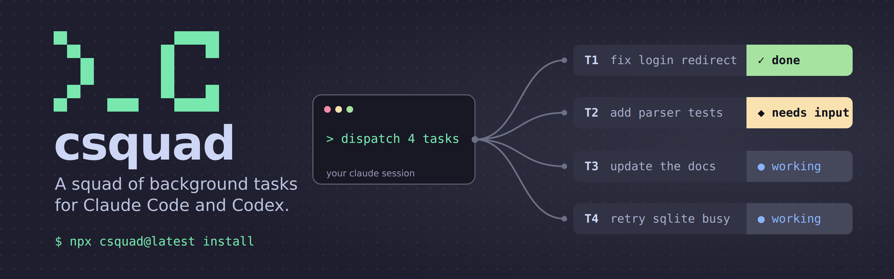

<p align="center">
  
</p>

<p align="center">
  <a href="https://www.npmjs.com/package/csquad"></a>
  <a href="LICENSE"></a>
</p>

**Hand work to a squad of background [Claude Code](https://claude.com/claude-code) sessions, and watch them from your status line.**

You keep talking to one normal `claude` session. Ask for a few tasks and each
becomes its own background session, `T1 · title`, `T2 · title`, ..., working in
its own git worktree while you carry on. One static binary, no daemon.

## Quick start

csquad 3 is a single Go binary. Until its npm packages exist, build it from
source (Go 1.26+, no C toolchain needed) and let it install itself:

```sh
git clone https://github.com/ShunL12324/c-squad.git && cd c-squad
CGO_ENABLED=0 go build -o csquad ./cmd/csquad
./csquad install
```

Then, in any `claude` session:

> Dispatch 3 tasks: fix the login redirect, add tests for the parser, update the docs.

That's it.

## How it works

```text
you     Dispatch 3 tasks: fix the login redirect, add tests for the parser, update the docs.
claude  launched T1 · fix login redirect, T2 · add parser tests, T3 · update the docs.
        They run in the background; check agent view or the status line.
```

Your status line now lists the tasks, most urgent first:

```text
▎ ◆ T2 add parser tests ··························  needs input   18m
▎ ✓ T1 fix login redirect ························  done        1h05m
▎ ● T3 update the docs ···························  working        7m
```

```text
you     How are my tasks going?
claude  T2 needs input: "Should the parser reject empty files or return []?" Answer it in
        agent view, or tell me and I'll pass it on. T1 is done: fixed the redirect loop on
        /login, tests pass, branch worktree-t1-fix-login-redirect. T3 is still working.
you     Tell T2 to return an empty list. Then merge T1.
claude  Sent to T2. T1 merged into main; its session, worktree and branch are removed.
```

Each task is a plain `claude --bg` session with a small set of worker rules
appended to its system prompt: work autonomously, use an isolated worktree and
branch, clean up after itself, commit, and end with a short result. Workers never
report back on their own, and nothing merges until you ask.

## The skills

Just ask; Claude picks the skill from what you say.

| Skill | What it does | Say something like |
| --- | --- | --- |
| `create-task` | Starts one background session per task, numbered `T1`, `T2`, ... | "Create a task to retry on SQLite busy errors." "Queue three tasks: ..." |
| `task-status` | Reports state and latest message of each task: needs input, failed, done, working | "How are my tasks going?" "Which tasks need input?" |
| `message-task` | Sends follow-up instructions to a task (Claude Code's native `SendMessage`) | "Tell T3 to also handle the empty-input case." |
| `watch-task` | Opt-in: runs a background command that checks the named tasks every 10 s and tells you when one needs input, finishes, fails or disappears. Never runs unless you ask | "Watch T3." "Tell me when T2 is done." "Stop watching." |
| `finish-task` | Merges a done task, then removes its session, worktree and branch, only after checking the work is merged | "Merge and clean up T2 and T4." "Finish everything that is done." |

## The status line

Your own status line stays exactly as it is; csquad prints it first, then one row
per task: its state, id and title, and how long it has been in that state.

| State | Meaning |
| --- | --- |
| `◆ needs input` | the task is waiting on an answer; reply in agent view |
| `✗ failed` | the session failed |
| `✓ done` | finished; ask Claude to merge it |
| `● working` | still running |
| `◇ idle` | finished its turn and waiting |
| `■ stopped` | stopped before finishing |

Wide terminals show two to four tasks side by side (from 124, 187 and 250
columns). At most four rows are used; when more tasks run, the last row lists
the rest as `+N more`. `NO_COLOR` turns colours off and keeps bold, faint and
reverse video.

The rows show only the tasks launched by the **current session**. `/clear`
starts a new session, so earlier tasks drop off the line but keep running; the
full list is always in agent view (`claude agents`), or ask Claude to
"show all tasks".

`install` wraps your existing `statusLine` instead of replacing it: the original
command is saved to `~/.csquad/statusline.json` and run at render time with the
same input. Other `settings.json` keys, ordering and indentation are untouched.
`uninstall` restores the original `statusLine` byte for byte (or removes the key
if you had none). A project-level `.claude/settings.json` that sets `statusLine`
overrides the wrapper in that project; `install` and `status` warn about it.

## Install, update, uninstall

```sh
csquad install          # copy the binary to ~/.csquad/bin, install the skills, wrap the status line
csquad update           # the same, for an existing installation (run it from a newer build)
csquad uninstall        # restore the status line, remove what install wrote
csquad status-install   # what is installed and whether the status line is wrapped
```

The skills go to `$CLAUDE_CONFIG_DIR/skills` (default `~/.claude`), everything
else to `$CSQUAD_HOME` (default `~/.csquad`):

```text
bin/csquad        the binary the skills and the status line run (absolute path)
csquad.db         the task ledger (SQLite, one table)
models.md         your model routing, optional, never written by csquad
statusline.json   your original status line
settings/T12.json a task's session settings while it runs (mode 600)
prompts/T12.md    a prompt too large for the command line
```

Install and update are idempotent. If you edited an installed skill, the next
run saves your version as `SKILL.md.bak` and says so. Uninstall keeps
`csquad.db` and `models.md`; running task sessions are not affected.

A csquad 1.x installation (`~/.claude/csquad/`) is not migrated: install stops
and asks you to run `npx csquad@1 uninstall` first, which restores your own
status line.

## Configuration

Model routing lives in `~/.csquad/models.md`, a short file you own: which
model or `claude` arguments for which kind of work. create-task reads it before
dispatching. Its `## When to use create-task` section (extra trigger phrases)
is appended to the installed skill's description by install and update.

For one task, ask Claude for any `claude` option ("use opus with high effort
for this one"): create-task passes everything after `--` in
`csquad launch … -- --model opus --effort high` to `claude --bg` unchanged,
overriding csquad's defaults (`--permission-mode bypassPermissions`).

Tasks normally work in their own worktree. Ask for one that edits your checkout
in place ("edit the main checkout so I can see it live") and create-task adds
`--isolation none`: Claude Code lets that task edit its working directory, and
it leaves its changes uncommitted for you.

A task uses the same provider as the session that launched it. Claude Code's
background service does not see your shell environment, so `ANTHROPIC_*`,
`CLAUDE_CODE_USE_*`, `CLAUDE_CODE_OAUTH_TOKEN` and `CLAUDE_CODE_SUBAGENT_MODEL`
from the launching session go into the task's settings file
(`~/.csquad/settings/T12.json`, mode 600, removed once the task is finished or
gone), never onto the command line or into your own `settings.json`. They are
forwarded all or nothing: when the task's `--settings`, your settings or the
project's choose a provider themselves, none are.

A task's worktree branches from your local HEAD (`worktree.baseRef: "head"`),
so it sees commits you have not pushed yet. Set `worktree.baseRef` yourself
(in your settings, the project's, or after `--`) to choose otherwise.

If a launch fails because the workspace is not trusted, open `claude` in that
directory once and accept the trust prompt.

## Requirements

- Claude Code with background sessions (`claude --bg`, `claude agents`);
  2.1.260 or newer for `claude rm --discard-unpushed`, which `csquad finish`
  uses for a worktree it verified merged (`install` and `status-install` warn
  on older versions)
- Linux, macOS or Windows (amd64, arm64). On Windows, Claude Code runs status
  line commands through Git Bash, so csquad does too for your original status
  line (without Git it falls back to `cmd.exe`); a native `claude.exe` or the
  npm `claude.cmd` both work. Windows builds and vets but has not been run yet.

## Development

```sh
go vet ./... && go test ./...   # temporary homes and a fake `claude`, never the real ones
```

See [CONTRIBUTING.md](CONTRIBUTING.md). MIT licensed.
