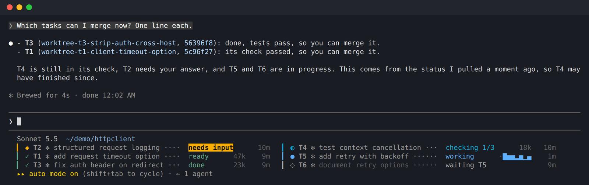
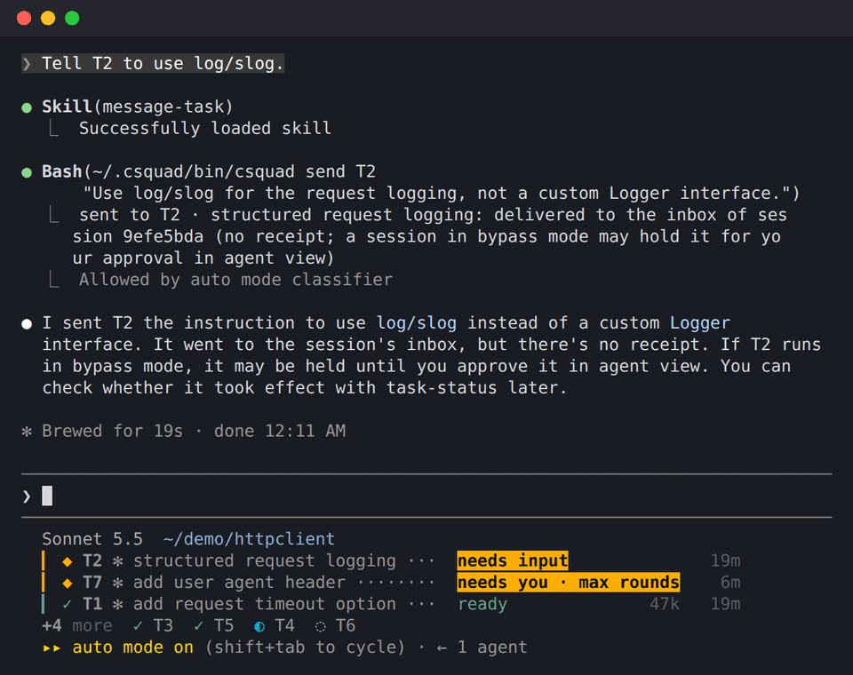
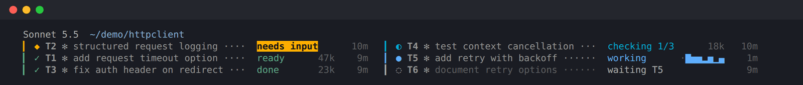

# csquad

<p>
  <a href="https://www.npmjs.com/package/csquad"></a>
  <a href="LICENSE"></a>
</p>

csquad lets you send coding tasks from your [Claude Code](https://claude.com/claude-code) or
Codex conversation to background sessions. Each task gets a name (`T1`, `T2`, …), its own git
worktree and a row in the Claude Code status line. You keep the conversation, and the tasks
work in parallel.


csquad is one binary with no service of its own. It installs five skills that Claude uses when
you ask for tasks, and it adds the task rows to your own status line.

- [Quick start](#quick-start)
- [Examples](#examples)
- [Read the status line](#read-the-status-line)
- [Command reference](#command-reference)
- [Configuration](#configuration)
- [Update and uninstall](#update-and-uninstall)
- [Troubleshooting and FAQ](#troubleshooting-and-faq)

## Quick start

### Requirements

- Claude Code with background sessions (`claude --bg`, `claude agents`). Use version 2.1.260 or
  newer. With an older version, `csquad finish` can leave the session of a finished task.
- Codex, if you want Codex tasks or Codex reviews. csquad is tested with codex-cli 0.163.0.
  csquad works without Codex.
- Node.js, for `npx` and `npm` only. csquad itself does not use Node.js.
- git. Each task works in a git worktree of your repository.
- Linux, macOS or Windows, on amd64 or arm64.

### Install

1. Run the installer:

   ```sh
   npx csquad@latest install
   ```

   Or install the package globally, then run the installer:

   ```sh
   npm i -g csquad
   csquad install
   ```

2. Check the installation:

   ```sh
   ~/.csquad/bin/csquad status-install
   ```

3. Start `claude` in a git repository, or restart it if it runs.
4. Ask Claude for a task, for example: "Create a task to add retry to the HTTP client."

The installer copies the binary to `~/.csquad/bin/csquad`. The skills and the status line use
this copy. The installer does not change your `PATH`. To type `csquad` in a shell, add
`~/.csquad/bin` to your `PATH`.

The installer also does these steps:

- It installs the skills into `~/.claude/skills`.
- It wraps your status line. Your own status line stays first, and the task rows come below it.
- If `~/.codex` exists, it installs the skills into `~/.agents/skills` for Codex too.

To build from source, see [CONTRIBUTING.md](CONTRIBUTING.md).

## Examples

Each example shows what you type in Claude Code, what Claude replies, and the csquad command that
Claude runs. You can also run the commands yourself in a shell.

The commands read the prompt from stdin. In PowerShell, pipe a here-string (`@' … '@`) into
`csquad launch`.

### Create a task

```text
you     Create a task to add retry to the HTTP client.
claude  Launched T1 · add http client retry. It works in the background.
```

The task is a background Claude Code session with the name `T1 · add http client retry`. It
creates its own worktree and branch, does the work, commits, and stops. It does not report back
by itself. Its row shows in your status line.

```sh
csquad launch --title "add http client retry" <<'PROMPT'
Add retry with exponential backoff to the Client in client.go.
Retry GET requests on network errors, 429 and 5xx. Add tests and run go test ./...
PROMPT
```

```text
launched T1 · add http client retry · session 93da1028 · ~/demo/httpclient
```

### Watch a task

The status line always shows the task. Ask Claude to watch it only if you want a message when it
changes.

```text
you     Watch T1 and tell me when it is done.
claude  Watching T1. I will tell you when it finishes or needs input.
        ...
claude  T1 is done: retries with backoff are on branch worktree-t1-http-client-retry,
        and go test passes. Do you want me to merge and finish it?
```

Claude runs `csquad wait` in the background. The command checks the task every 10 seconds and
uses no tokens. It returns when a task needs input, finishes, fails or is removed, or after 4 hours.

```sh
csquad wait T1                # returns with one line per task, e.g. "T1 · add http client retry · done"
csquad status                 # this session's tasks: state, age, session, latest message
csquad peek T1 -n 8           # the last 8 messages of the task, tool calls folded
```

To ask for a report at any time, ask "How are my tasks going?".



### Finish and merge a task

```text
you     Merge T1.
claude  Merged worktree-t1-http-client-retry into main, and go test passes.
        T1 is finished: its worktree, branch and session are removed.
```

Claude merges the task's branch into the branch of your main checkout. Then it runs
`csquad finish`. This command removes the task only when the work is safe:

1. It makes sure that each branch of the task is merged into the target branch.
2. It makes sure that the worktree has no uncommitted changes.
3. It removes the worktree, the merged branches and the session.

If a check fails, `csquad finish` stops and tells you what is not merged. It never deletes
unmerged work.

```sh
git merge worktree-t1-http-client-retry
csquad finish T1
```

```text
finished T1 · add http client retry · merged into main: worktree-t1-http-client-retry · removed worktree ~/demo/httpclient/.claude/worktrees/t1-http-client-retry, branch worktree-t1-http-client-retry, removed session 93da1028
```

Say "finish everything that is done" to finish all tasks of this session that are done, idle or
ready.

### Run two tasks in parallel

```text
you     Create two tasks: add a request timeout option, and fix the auth header leak on redirect.
claude  Launched T2 · add request timeout option and T3 · fix auth header on redirect.
```

Each task has its own session, worktree and branch, so the tasks do not change the same files on
disk. Claude puts work on the same code into one task.

```sh
csquad launch --title "add request timeout option" <<'PROMPT'
Add a Timeout option to the Client in client.go. Add a test and run go test ./...
PROMPT
csquad launch --title "fix auth header on redirect" <<'PROMPT'
Drop the Authorization header when a redirect goes to another host. Add a test.
PROMPT
```

### Start a task after another task

```text
you     Create a task to document the retry options, after T1.
claude  Queued T4 · document retry options. It starts when T1 is done.
```

The status line shows `waiting T1`. T4 starts when T1 is merged and finished. Its prompt then
gets the merged branch and the last message of T1. A task that is only `ready` does not start T4.

```sh
csquad launch --title "document retry options" --after T1 <<'PROMPT'
Document the retry options in README.md: what is retried, the defaults, and an example.
PROMPT
```

```text
queued T4 · document retry options · after T1 · ~/demo/httpclient
```

### Let Codex review a task, then merge it

```text
you     Create a task to add a circuit breaker. Let codex review it, at most 3 rounds,
        and merge it when it passes.
claude  Launched T5 · add circuit breaker. Codex checks it when it stops, at most 3 rounds,
        and csquad merges it into main when the check passes.
```

This is the full flow:

1. The task works and stops.
2. csquad starts a new read-only Codex reviewer. The status line shows `checking 1/3`.
3. If the review fails, csquad sends the findings to the task. The status line shows `fixing 2/3`.
4. If the review passes, the task rebases its branch onto `main`. The status line shows `merging`.
5. csquad fast-forwards `main`, makes sure that the merge is complete, and removes the task.

If the last round fails, or the merge has a conflict, the task stops with `needs you · reason`.

```sh
csquad launch --title "add circuit breaker" --check codex --max 3 --merge <<'PROMPT'
Add a circuit breaker to the Client: stop retries after N consecutive failures
for a cool-down period. Add tests and run go test ./...
PROMPT
```

```text
launched T5 · add circuit breaker · session 2876bd02 · ~/demo/httpclient
  then: check codex, at most 3 rounds · merge into main
```

Other checks:

- `--check claude` or `--check claude:sonnet`: a Claude Code reviewer, with an optional model.
- `--check codex:MODEL`: a Codex reviewer with a model.
- `--check 'cmd:go test ./...'`: a command in the task's worktree. Exit status 0 passes.
- Without `--merge`, a task that passes its check shows `ready`. Merge it as in
  [Finish and merge a task](#finish-and-merge-a-task).

### Run a task in Codex

```text
you     Run it in codex: add structured request logging with log/slog.
claude  Launched T6 · add request logging (Codex). Open it with codex resume <thread>.
```

The task is a Codex thread with the name `T6 · add request logging`. It runs on Codex's
app-server. csquad starts the app-server if it does not run. The thread creates its worktree
`<repo>-wt/t6-slug` on the branch `task/t6-slug`. The status line marks Codex tasks with `⬡` and
Claude Code tasks with `✻`.

```sh
csquad launch --title "add request logging" --engine codex -- --effort high <<'PROMPT'
Add structured request logging to the Client with log/slog. Add tests.
PROMPT
```

After `--`, a Codex task accepts `-m/--model`, `--effort`, `-s/--sandbox`,
`-a/--ask-for-approval` and `-c/--config KEY=VALUE`. The defaults are `danger-full-access` and
`never`. The commands `status`, `peek`, `send`, `wait`, `finish`, `cancel` and `retry` work for
Codex tasks as for Claude Code tasks.

### Send a message to a task



```text
you     Tell T2 to use log/slog.
claude  I sent T2 the instruction to use log/slog.
```

csquad delivers the message to the task's session. A session that has stopped starts again with
the message. A Codex task gets the message in its current turn, or in a new turn.

```sh
csquad send T2 "Use log/slog for the request logging, not a custom Logger interface."
```

```text
sent to T2 · structured request logging: delivered to the inbox of session 9efe5bda (no receipt)
```

csquad sets `"crossSessionInbound": "accept"` in the settings of each task, so Claude Code
delivers the message at once. If you set a different value with `-- --settings`, Claude Code
can hold the message until you approve it in agent view.

### More requests

| You say | Claude adds | Effect |
| --- | --- | --- |
| "Use opus with high effort for this one." | `-- --model opus --effort high` | Arguments after `--` go to `claude --bg` unchanged. |
| "Edit my checkout in place, so I can see it live." | `--isolation none` | The task edits your checkout. It makes no branch and does not commit. |
| "Fork this into a task, with what we discussed." | `--fork` | The task starts as a fork of this conversation. |
| "Run it in ~/work/api." | `--cwd ~/work/api` | The task runs in that directory. |

## Read the status line



Each task has one row. A row has these parts, from left to right:

1. A colored bar and a glyph for the state.
2. The task ID and the engine mark: `✻` for Claude Code, `⬡` for Codex.
3. The title, with a dotted leader.
4. The state.
5. The usage: the total and the new tokens, the total only, or nothing.
6. The time since the task entered its state.

The most urgent tasks come first.

| Glyph | State | Meaning | What to do |
| --- | --- | --- | --- |
| `◆` | `needs input` | The task asks you a question. | Answer in agent view, or tell Claude the answer. |
| `◆` | `needs you · reason` | csquad stopped the flow of the task. | Read the reason, then run `csquad retry T7`. |
| `✗` | `failed` | The session failed. | Read it with `csquad peek T7`. |
| `✓` | `done` | The task finished its work. | Merge and finish it. |
| `✓` | `ready` | The task passed its check. | Merge and finish it. |
| `⇡` | `merging` | csquad merges the branch of the task. | Wait. |
| `◑` | `fixing 2/3` | The check failed. The task fixes the findings in round 2 of 3. | Wait. |
| `◐` | `checking 1/3` | The check runs, round 1 of 3. | Wait. |
| `●` | `working` | The task works. | Wait. |
| `◇` | `idle` | The task ended its turn and waits. | Read it, then send a message or finish it. |
| `◌` | `waiting T5` | The task waits for T5. It has no session yet. | Finish T5. |
| `■` | `stopped` | The session stopped before the end. | Send a message to start it again, or cancel it. |

### The "needs you" badge

The states `needs input` and `needs you` show as an amber badge. `needs you` gives the first part
of the reason, for example `needs you · max rounds` or `needs you · merge conflict`. Run
`csquad status` to see the full reason. Run `csquad retry T7` to continue where the task stopped:

- `max rounds`: the task gets one more fix round.
- `no verdict`: the check runs again.
- `merge conflict`, `merge stopped`: the merge runs again.
- `dependency gone`: the task waits again.

### The usage

A task that is `working`, `checking`, `fixing` or `merging` shows its total, then the new tokens
since the refresh before (about 10 seconds), for example `326k  +4.1k`:

| After the total | Meaning |
| --- | --- |
| `+4.1k` | New tokens since the last refresh. |
| `+0` | No change. It shows faint. |
| `+?` | The session changed, but its provider reports no token counts, or only some. |
| `idle 3m` | No activity for 2 minutes or more. The time shows in amber. The state does not change. A `checking` task shows no `idle`: it waits for its check. |

Other tasks show their total only, faint: `326k`, `1.2M`, or `?` when the total is not known.
The total counts input, cache writes and output. It does not count cache reads.

`csquad status` shows the full usage of each working task:

```text
## T365 · cancel smoke
state: working · started 27s ago · session ca47ac83 · ~/project
usage: 51.8k fresh · +0 since the last refresh (0 s) · last activity 13s ago
       input 4 · cache write 51.1k · output 622  cache read 50.5k (not counted)
       context 26% (51k of 200k) · status line +0 in 10 s
```

### Width and number of rows

- The status line uses one column of tasks below 124 terminal columns. It uses 2 columns from 124,
  3 from 187 and 4 from 250.
- It uses at most 4 rows. When more tasks exist, the last row shows `+N more` with the glyph and
  ID of each other task.
- A row is at most 4 cells narrower than the terminal: Claude Code indents the status line and
  cuts longer rows.
- In a narrow terminal, the title gets shorter first. Then the usage drops the new tokens, then
  the total, and the reason of a `needs you` badge gets shorter. The age is never cut.
- `NO_COLOR` removes the colors. The glyphs, bold, faint and reverse video stay.

### Which tasks show

The status line shows only the tasks that the current conversation created. `/clear` starts a new
conversation, so earlier tasks go from the status line, but they continue to run. To see all
tasks, open agent view (`claude agents`), run `csquad status --all`, or ask Claude to "show all
tasks".

## Command reference

`csquad COMMAND --help` shows the usage of one command. `T12` is a task ID. Most commands accept
`--all` for a task of another session.

| Command | Description |
| --- | --- |
| `launch --title T [flags] [-- ENGINE_ARGS]` | Start a task. The prompt comes from stdin or `--prompt-file`. |
| `status [--all] [--json]` | Show the tasks of this session: state, age, session, latest message. |
| `peek T12 [-n 6]` | Show the last messages of a task, with tool calls folded. The last reply shows in full. |
| `wait T12 [T13...] [--timeout MIN]` | Return when a task needs input, finishes, fails or is removed. |
| `send T12 "text"` | Send a follow-up instruction. The text comes from stdin when omitted. |
| `finish T12 [T13...] [--into BRANCH]` | Make sure that the work is merged and clean, then remove worktrees, branches and the session. |
| `cancel T12 [--discard]` | Stop a task and remove it from the list. Unmerged work stays unless `--discard`; `--discard` also works on a task that is already cancelled. |
| `retry T12` | Continue a task that needs you, where it stopped. |
| `statusline` | The status line command. It reads the JSON of Claude Code on stdin. |
| `install` | Install the binary to `~/.csquad/bin`, the skills, and the status line wrapper. |
| `update` | Do the same for an existing installation. |
| `uninstall` | Restore the status line and remove what `install` wrote. Keeps `csquad.db` and `models.md`. |
| `status-install` | Show what is installed. |
| `version`, `help` | Show the version or the usage. |

The commands `hook`, `check` and `advance` are internal. The Stop hooks and the status line use
them.

Flags of `launch`:

| Flag | Description |
| --- | --- |
| `--title T` | The task title. The ID comes first: `T12 · title`. Required. |
| `--cwd DIR` | Run the task in DIR. The default is the current directory. |
| `--engine claude\|codex` | The engine. The default is `claude`. |
| `--model M` | The model of the task. |
| `--after T3,T4` | Wait until these tasks are done, then start. |
| `--check SPEC` | Check the work when the task stops: `codex[:MODEL]`, `claude[:MODEL]` or `cmd:COMMAND`. |
| `--max N` | The maximum number of check rounds. The default is 3. |
| `--merge [BRANCH]` | Merge the work when it is done and checked. The default is the branch of the main checkout. |
| `--isolation none` | Edit the working directory in place. No worktree, no branch, no commit. |
| `--fork` | Start as a fork of the current conversation. Not with `--after`. |
| `--prompt-file F [--rm-prompt]` | Read the prompt from F. `--rm-prompt` deletes F after it is read. |
| `--no-worker-rules` | Leave out the worker rules, for a prompt that has its own rules. |
| `-- ENGINE_ARGS` | Arguments for the engine: `claude --bg` options, or Codex thread options. |

## Configuration

### Model routing: `~/.csquad/models.md`

You own this file, and csquad never writes it. Claude reads it before each launch. Use it to tell
Claude which engine, model and arguments to use for which kind of work. Keep it short, and name
each model explicitly. Without a model, the task uses the default model of the engine.

```markdown
# Model routing

- Small fixes, docs, tests: claude, `-- --model haiku`
- Features and refactors: claude, `-- --model opus --effort high`
- Reviews: `--check codex`

## When to use create-task

Also use it when I say "farm this out" or "background this".
```

`install` and `update` add the section `## When to use create-task` to the description of the
create-task skill. Use it for your own trigger phrases. Run `csquad update` after you change it.

### Environment variables

| Variable | Default | Use |
| --- | --- | --- |
| `CSQUAD_HOME` | `~/.csquad` | The binary, the task database `csquad.db`, `models.md`, logs and cache. |
| `CLAUDE_CONFIG_DIR` | `~/.claude` | The Claude Code configuration. The skills go into its `skills` directory. |
| `CODEX_HOME` | `~/.codex` | The Codex configuration. If it exists, `install` also sets up Codex. |
| `NO_COLOR` | not set | Any value removes the colors from the status line. |

Claude Code's background service does not see your shell environment. So `csquad launch` copies
these variables from the current session into the settings of the task:

- `ANTHROPIC_*`
- `CLAUDE_CODE_USE_*`
- `CLAUDE_CODE_OAUTH_TOKEN`
- `CLAUDE_CODE_SUBAGENT_MODEL`

The task then uses the same provider as your session. csquad writes them to
`~/.csquad/settings/T12.json` (mode 600), never to the command line. It deletes the file when the
task is finished. If the settings of the task, your settings or the project settings choose a
provider, csquad copies none of these variables.

### Worktrees

A Claude Code task creates its worktree from your local `HEAD`, so it sees commits that you did not
push. csquad sets `worktree.baseRef` to `"head"` for this. To change it, set `worktree.baseRef` in
your settings, in the project settings, or after `--`.

### Files

```text
~/.csquad/
  bin/csquad         the binary that the skills and the status line run
  csquad.db          the task database (SQLite)
  models.md          your model routing (optional, never written by csquad)
  statusline.json    your original status line
  settings/T12.json  the session settings of a task while it exists (mode 600)
  prompts/T12.md     a prompt that is too long for the command line
  cache/             the last status line output and the usage readings
  logs/              check logs, events.jsonl (one line per phase change), advance.log
~/.claude/skills/    create-task, task-status, message-task, watch-task, finish-task
```

### The status line wrapper

`install` keeps your own status line. It saves the command in `~/.csquad/statusline.json` and runs
it first, with the same input. It changes no other key in `settings.json`. `uninstall` restores the
original `statusLine` exactly, or removes the key if you had none.

### Codex

When `$CODEX_HOME` exists, `install` also does these steps:

- It installs the skills into `~/.agents/skills`, so a Codex session can create tasks.
- It adds one Stop hook group to `~/.codex/hooks.json`, marked `"__csquad__": true`.

Approve the hook once with `/hooks` in Codex. Codex must run `csquad` outside its sandbox. Codex
has no status line, so Codex sessions show no task rows. Use `csquad status` or ask "How are my
tasks going?".

## Update and uninstall

### Update

Run one of these commands:

```sh
npx csquad@latest update
~/.csquad/bin/csquad update     # after an npm installation, this runs npx csquad@latest update
```

`npx csquad@3 install` stays on version 3.x. `install` and `update` are idempotent. If you edited
a skill, `update` saves your version as a `.bak` file next to it and tells you.

### Uninstall

```sh
~/.csquad/bin/csquad uninstall
```

`uninstall` restores your status line and removes the skills, the binary and the Codex hook.
It keeps `~/.csquad/csquad.db` and `~/.csquad/models.md`. Running tasks continue to run.

### Move from csquad 1.x

csquad 3 does not migrate a 1.x installation (`~/.claude/csquad/`).

1. Remove 1.x. This restores your own status line:

   ```sh
   npx csquad@1 uninstall
   ```

2. Install csquad 3:

   ```sh
   npx csquad@latest install
   ```

If you run `install` first, it stops, changes nothing, and asks you to remove 1.x.

## Troubleshooting and FAQ

**The status line shows no task rows.**
Run `~/.csquad/bin/csquad status-install`. If `.claude/settings.json` in the project sets its own
`statusLine`, that status line replaces the wrapper in that project. Also, the rows show only the
tasks of the current conversation. After `/clear`, run `csquad status --all`.

**A launch fails because the workspace is not trusted.**
Open `claude` in that directory once and accept the trust prompt. Then ask again.

**A task fails with "Login expired" or uses the wrong provider.**
The task uses the provider variables of the session that created it. Start `claude` from a shell
that has these variables, then create the task again.

**I sent a message, but the task did nothing.**
Claude Code holds a message for your approval when the task's settings do not accept
cross-session messages. csquad accepts them by default; a `crossSessionInbound` value in your
`-- --settings` changes that. Open agent view (`claude agents`), select the task and approve
the message. Such a task shows `needs input` in `csquad status` and the status line, also when
it was done.

**A task shows `needs you · max rounds`.**
The check failed in each round. Run `csquad status` to read the findings. Send a message with a
hint, then run `csquad retry T7` for one more round. Or cancel the task.

**`csquad finish` refuses to remove a task.**
The output names the branch that is not merged, or the worktree that has uncommitted changes.
Merge or commit the work, then run `csquad finish` again. To delete the work, run
`csquad cancel T7 --discard`.

**How many tasks can run at the same time?**
csquad sets no limit. Each task uses its own session and tokens, so you decide how many to run.

**Does a task merge by itself?**
No. A task merges only with `--merge`, that is, when you ask for it ("merge it when it passes").
Otherwise you ask Claude to merge it.

**Where is the history of a task?**
`~/.csquad/logs/events.jsonl` has one line for each phase change. `csquad peek T12` shows the
conversation of the task.

**`npm i -g csquad` installed no binary.**
npm installs the binary as an optional dependency, for example `@shunl12324/csquad-linux-x64`.
With optional dependencies turned off (`--omit=optional`), npm installs no binary, and the
`csquad` command tells you. Install again with optional dependencies.

## Contributing

To build csquad, run the tests or make a release, see [CONTRIBUTING.md](CONTRIBUTING.md).

MIT licensed. See [LICENSE](LICENSE).
